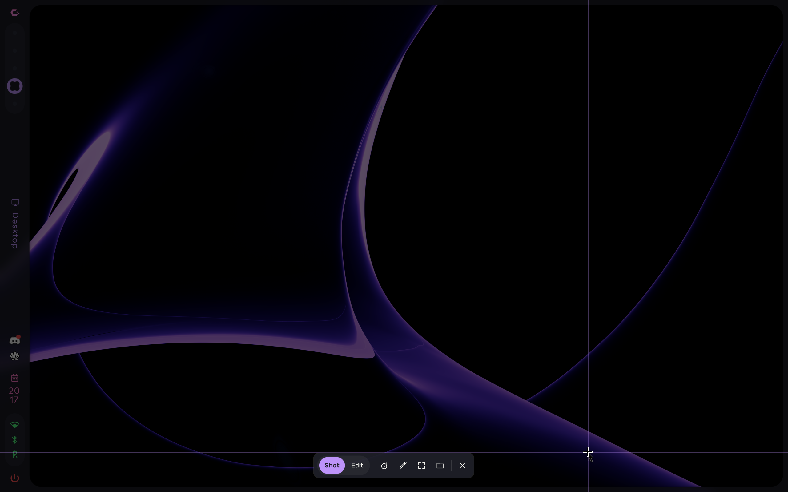
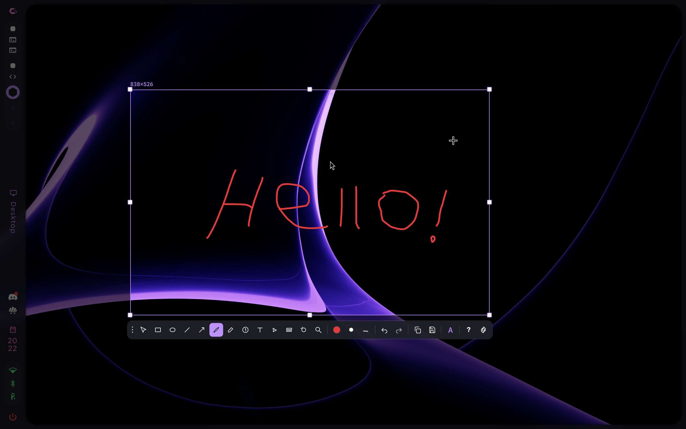
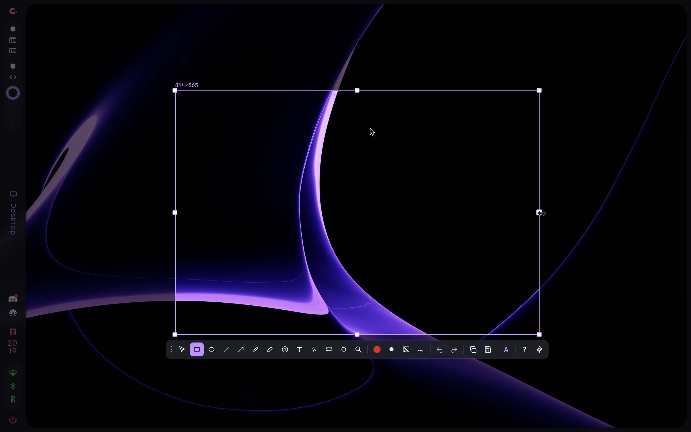

<div align="center">

# asteroid

**A screenshot tool for Hyprland that freezes the screen the moment you press Print, and looks like the rest of your Caelestia desktop.**

[](https://github.com/J-0-S-E/asteroid/commits/main)
[](#install)
[](https://github.com/caelestia-dots/shell)
[](https://github.com/ryoku-dev/ryoku)
[](LICENSE)

[Screenshots](#screenshots) · [Install](#install) · [Make it yours](#make-it-yours) · [Credits](#credits) · [AI declaration](#ai-declaration)

</div>

<br>



## Why this exists

My desktop runs [Caelestia](https://github.com/caelestia-dots/shell) on Hyprland. The best screenshot tool I had
tried was ryoshot from [Ryoku](https://github.com/ryoku-dev/ryoku), but it is part of a whole desktop and needs
Ryoku's services to run. I wanted just the screenshot tool, so asteroid is ryoshot cut loose: no Ryoku, no
network, and colours taken from the Caelestia scheme you already have.

The name? A shooting star is a meteor, and that name was taken. An asteroid is close enough.

## What you get

| | |
|---|---|
| **Freeze on press** | Every monitor is grabbed with `grim` the instant the key goes down, so menus and tooltips stay in the shot |
| **Ready in the background** | A standby instance waits with Quickshell already loaded, so the overlay skips the startup |
| **Pick anything** | Drag a region, click a window, or take the whole monitor. Space cycles between them |
| **Annotate** | Arrows, lines, boxes, ellipses, pen, text, numbered steps, blur, mosaic and zoom |
| **Your colours** | Follows `~/.local/state/caelestia/scheme.json` live. Change the scheme and asteroid changes with it |
| **Copy or save** | Enter copies and saves. Screenshots go to `~/Pictures/Screenshots` |
| **Offline** | No network access at all. The upload, search and OCR features from ryoshot are removed |

## Screenshots

<table>
  <tr>
    <td></td>
    <td></td>
  </tr>
  <tr>
    <td align="center">Pen on a selected region, Dracula</td>
    <td align="center">The same toolbar in Darkgreen</td>
  </tr>
</table>

## Install

You need Hyprland with the Lua config, `quickshell`, `grim`, `jq` and `wl-clipboard`. ImageMagick, and `zenity`
or `kdialog`, are optional.

```bash
git clone https://github.com/J-0-S-E/asteroid
cd asteroid
./install.sh
```

The installer copies the Quickshell config to `~/.config/quickshell/asteroid` and the two scripts to
`~/.local/bin`. It does not touch your Hyprland config. Add these lines yourself, for example in
`~/.config/caelestia/hypr-user.lua`:

```lua
hl.bind("Print", hl.dsp.exec_cmd("~/.local/bin/asteroid"))
hl.exec_cmd("~/.local/bin/asteroid-standby")
hl.layer_rule({ match = { namespace = "asteroid" }, no_anim = true })
```

<details>
<summary><b>Laptop tips</b></summary>
<br>

- On many Lenovo laptops <kbd>Fn</kbd> + <kbd>Print</kbd> sends <kbd>Super</kbd> + <kbd>Shift</kbd> + <kbd>S</kbd>.
  Bind that to asteroid as well, and set `kbScreenshotFreeze = {}` in `hypr-vars.lua` so Caelestia lets go of it.
- The full path matters: `~/.local/bin` is often not in Hyprland's `PATH`.

</details>

To remove it: `./install.sh uninstall`. Your settings in `~/.config/asteroid/` are left alone.

## Make it yours

Settings live in `~/.config/asteroid/config.json` and are saved from the settings panel.

| Key | What it does |
|---|---|
| `saveDir` | Where screenshots go. Empty means `~/Pictures/Screenshots` |
| `copyOnSave` | Also copy to the clipboard when you save |
| `delaySeconds` | Countdown before the shot |
| `blurRadius` | Strength of the blur tool (64 by default) |
| `mosaicBlock` | Block size of the mosaic tool (12 by default) |
| `zoomFactor` | Magnification of the zoom tool (2 by default) |

<details>
<summary><b>Keyboard shortcuts</b></summary>
<br>

| Key | Action |
|---|---|
| <kbd>Enter</kbd> | Copy and save |
| <kbd>Ctrl</kbd> + <kbd>C</kbd> / <kbd>Ctrl</kbd> + <kbd>S</kbd> | Copy / save |
| <kbd>Ctrl</kbd> + <kbd>B</kbd> | Beautify |
| <kbd>Ctrl</kbd> + <kbd>A</kbd> | Whole monitor |
| <kbd>Space</kbd> | Cycle region, window and monitor |
| <kbd>1</kbd> … <kbd>8</kbd> | Colour |
| <kbd>[</kbd> <kbd>]</kbd> | Stroke width |
| <kbd>F</kbd> / <kbd>K</kbd> | Fill / sketch style |
| <kbd>Ctrl</kbd> + <kbd>Z</kbd> / <kbd>Ctrl</kbd> + <kbd>Shift</kbd> + <kbd>Z</kbd> | Undo / redo |
| <kbd>Del</kbd> | Delete the selected annotation |
| <kbd>Esc</kbd> | Back, or close |

</details>

## Credits

- **[ryoshot](https://github.com/ryoku-dev/ryoku)** from Ryoku by ryoku-dev (GPL-3.0). asteroid is a fork of it,
  and almost all of the tool itself is their work. What changed is listed in [`NOTICE`](NOTICE)
- **[Caelestia](https://github.com/caelestia-dots/shell)**, whose colour schemes asteroid follows
- **[Quickshell](https://quickshell.outfoxxed.me)** and **[grim](https://sr.ht/~emersion/grim/)**, which do the
  heavy lifting

## AI declaration

asteroid is made with AI. The port, the scripts and this README were written by Claude in Claude Code
(Anthropic). I decided what to build and how it should behave, tested every change on my own laptop, and went back
and forth until it was right. The commits list Claude as co-author.

How I use it: one main chat on **Claude Opus 5.5**, which is the brain. It holds the conversation, makes the plan,
takes the design calls and checks everything before it is used. Bigger jobs that are clearly defined go to
subagents on cheaper models:

- **Claude Sonnet** for building to an agreed plan: cutting ryoshot loose from Ryoku, the Caelestia colours, the
  launcher, standby script and installer
- **Opus 5.5** itself for the rest: the security check of the Ryoku source before anything was copied, the review
  of Sonnet's work, the fix that made the freeze happen on the key press, the keybinds and the screenshots, taken
  with `grim` while the overlay was open

The screenshot tool underneath is ryoshot, written by the Ryoku authors.

<br>

<p align="center">
  
</p>
